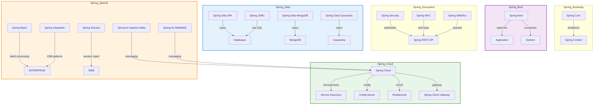

# Core Spring Boot

## What is Spring?

**Spring** is a lightweight, comprehensive framework for Java enterprise application development. Created by Rod Johnson and first released in 2004, it aims to "J2EE simplified" - making enterprise Java development easier, more productive, and less complex.

The framework provides:
- **Inversion of Control (IoC)** - Decouples object creation from business logic
- **Aspect-Oriented Programming (AOP)** - Cross-cutting concerns (logging, security, transaction management)
- **Comprehensive programming model** - For all layers of an enterprise application

> **"Spring exists to simplify J2EE development, making it easier to write code that's testable, loosely coupled, and maintainable."** - Rod Johnson

---

## Core Components

| Component | Module | Purpose |
|---|---|---|
| **Spring Core** | `spring-core` | The foundation. Provides **IoC** and **DI** (Dependency Injection). The `BeanFactory` is the heart that instantiates, configures, and manages objects (beans). |
| **Spring Context** | `spring-context` | Application context, enterprise services, JNDI, EJB integration. Extends BeanFactory with lifecycle management, event propagation, resource loading. |
| **Spring AOP** | `spring-aop` | Aspect-oriented programming implementation. Supports both proxy-based and AspectJ-native approaches for cross-cutting concerns (logging, transactions, security). |
| **Spring DAO** | `spring-jdbc` | Database access abstraction. Provides meaningful error messages and helps avoid common errors of database driver code (try-finally, resource cleanup). |
| **Spring ORM** | `spring-orm` | Integration layer for ORM frameworks: **Hibernate**, **JPA**, **iBatis**, **MyBatis**. Lets you use their features while getting Spring's services. |
| **Spring Web** | `spring-web` | Basic web-oriented integration: servlet context, multipart file handling, initialization of the Inverse IoC container. |
| **Spring MVC** | `spring-webmvc` | Model-View-Controller web framework. RESTful web services, request mapping, model binding, view resolution. |
| **Spring Security** | `spring-security` | Authentication and authorization. Core security services, ACLs, CSRF protection, OAuth2, JWT integration. |
| **Spring Test** | `spring-test` | Testing support. JUnit/TestNG integration, Spring context loading, mock objects for testing. |

### Mermaid: Spring Core Component Diagram
```mermaid
flowchart TD
    subgraph Core
        BC[BeanFactory] -->|manages| BC1[Beans: POJOs]
        BC -->|dependencies| DI[Dependency Injection]
    end

    subgraph Context
        CTX[ApplicationContext] -->|extends| BC
        CTX -->|enterprise services| SERV[EJB, JNDI, resources]
    end

    subgraph AOP
        AOP[AOP Framework] -->|proxies| AOP1[AspectJ integration]
        AOP -->|advice| AOP2[Before/After/Around]
    end

    subgraph Data
        DAO[Spring JDBC] -->|abstraction| DB[Database]
        ORM[Spring ORM] -->|integrates| HF[Hibernate/JPA]
        ORM -->|integrates| IB[iBatis/MyBatis]
    end

    subgraph Web
        MVC[Spring MVC] -->|request handling| SERVLET[Servlet Container]
        SEC[Spring Security] -->|auth/authorization| MVC
    end

    style Core fill:#e3f2fd,stroke:#1976d2,stroke-width:2px
    style Context fill:#e3f2fd,stroke:#1976d2,stroke-width:2px
    style AOP fill:#e3f2fd,stroke:#1976d2,stroke-width:2px
    style Data fill:#e3f2fd,stroke:#1976d2,stroke-width:2px
    style Web fill:#e3f2fd,stroke:#1976d2,stroke-width:2px
```

### Mermaid: Spring Bean Lifecycle
```mermaid
flowchart TD
    direction TB
    B1[Bean Definition Registration] --> B2[Instantiation]
    B2 --> B3[Dependency Injection via Constructor]
    B3 --> B4[Population (Setter/Field)]
    B4 --> B5[Initialization]
    B5 --> B6{Aware Interfaces}
    B5 --> B7[Post-Construct]
    B6 --> B7
    B7 --> B8[Ready for Use]
    B8 --> B9[Context Closed]
    B9 --> B10[Destruction]
    B10 --> B11[DisposableBean]
    B11 --> B12[Garbage Collected]
    
    style B1 fill:#e3f2fd,stroke:#1976d2,stroke-width:2px
    style B7 fill:#e3f2fd,stroke:#1976d2,stroke-width:2px
    style B11 fill:#e3f2fd,stroke:#1976d2,stroke-width:2px
```

### Mermaid: Spring Core Component Diagram
```mermaid
flowchart TD
    subgraph Core
        BC[BeanFactory] -->|manages| BC1[Beans: POJOs]
        BC -->|dependencies| DI[Dependency Injection]
    end

    subgraph Context
        CTX[ApplicationContext] -->|extends| BC
        CTX -->|enterprise services| SERV[EJB, JNDI, resources]
    end

    subgraph AOP
        AOP[AOP Framework] -->|proxies| AOP1[AspectJ integration]
        AOP -->|advice| AOP2[Before/After/Around]
    end

    subgraph Data
        DAO[Spring JDBC] -->|abstraction| DB[Database]
        ORM[Spring ORM] -->|integrates| HF[Hibernate/JPA]
        ORM -->|integrates| IB[iBatis/MyBatis]
    end

    subgraph Web
        MVC[Spring MVC] -->|request handling| SERVLET[Servlet Container]
        SEC[Spring Security] -->|auth/authorization| MVC
    end

    style Core fill:#e3f2fd,stroke:#1976d2,stroke-width:2px
    style Context fill:#e3f2fd,stroke:#1976d2,stroke-width:2px
    style AOP fill:#e3f2fd,stroke:#1976d2,stroke-width:2px
    style Data fill:#e3f2fd,stroke:#1976d2,stroke-width:2px
    style Web fill:#e3f2fd,stroke:#1976d2,stroke-width:2px
```

---

## How Spring Works

### 1. **Inversion of Control (IoC)**
The core idea: **Don't create your objects - let the framework create and manage them.**

- **Traditional Java:** You `new` up dependencies directly in your code.
- **Spring:** You declare what you need, and Spring injects it.

```java
// Traditional approach
public class OrderService {
    private final OrderRepository repo = new JdbcOrderRepository(); // tight coupling
}

// Spring approach
public class OrderService {
    private final OrderRepository repo; // just declare
    
    // Spring will inject this via constructor
    public OrderService(OrderRepository repo) {
        this.repo = repo;
    }
}
```

### 2. **Dependency Injection (DI)**
A subset of IoC. Dependencies are "injected" into a class through:
- **Constructor injection** (recommended - ensures immutability, required deps)
- **Setter injection** (optional deps, re-injection possible)
- **Field injection** (not recommended, bypasses encapsulation)

### 3. **The Spring Container Lifecycle**

```text
┌─────────────────────────────────────────────────────────┐
│                   Spring Container                       │
│  (BeanFactory or ApplicationContext)                     │
├─────────────────────────────────────────────────────────┤
│  1. Bean Definition Registration                         │
│     - XML / annotations / Java config                    │
│     - Bean class, scope, init-method, destroy-method     │
├─────────────────────────────────────────────────────────┤
│  2. Instantiation                                        │
│     - Create bean instance via constructor                │
│     - Dependency injection (constructor params)          │
├─────────────────────────────────────────────────────────┤
│  3. Population                                           │
│     - Setter injection                                   │
│     - Field injection                                      │
├─────────────────────────────────────────────────────────┤
│  4. Initialization                                       │
│     - Implement InitializingBean / @PostConstruct        │
│     - Custom init-method                                   │
├─────────────────────────────────────────────────────────┤
│  5. Usage                                                │
│     - Bean is ready, application code uses it            │
├─────────────────────────────────────────────────────────┤
│  6. Destruction                                          │
│     - Implement DisposableBean / @PreDestroy             │
│     - Custom destroy-method                                │
└─────────────────────────────────────────────────────────┘
```

### 4. **Bean Scopes**
- **singleton** (default): One instance per Spring container (per JVM)
- **prototype**: New instance every time you request it
- **request**: One instance per HTTP request (web apps)
- **session**: One instance per HTTP session (web apps)
- **application**: One instance per `ServletContext`
- **websocket**: One instance per WebSocket session

### 5. **Auto-configuration (Spring Boot)**
Spring Boot's killer feature. It automatically configures your application based on the dependencies on the classpath.

```text
Example: If spring-boot-starter-data-jpa + HikariCP on classpath →
  - DataSource auto-configured
  - EntityManagerFactory auto-configured
  - TransactionManager auto-configured
  - No manual XML or boilerplate needed
```

---

## Different Spring Projects (Ecosystem)

Spring is not just one framework—it's an ecosystem of related projects. Here's the modern landscape:



### Key Projects Breakdown:

| Project | Category | Purpose |
|---|---|---|
| **Spring Boot** | Rapid App Dev | Convention-over-configuration, embedded servers, starters. **The on-ramp for most Spring projects today.** |
| **Spring Cloud** | Microservices | Service discovery (Eureka, Consul), distributed config, circuit breakers (Resilience4j), API gateway, client-side load balancing. |
| **Spring Data** | Data Access | Repository abstraction for **JPA, MongoDB, Cassandra, Redis, Redis, LDAP, SQL databases**. Write less boilerplate CRUD. |
| **Spring Security** | Security | Authentication, authorization, CSRF, OAuth2, JWT, method-level security (@PreAuthorize). |
| **Spring MVC / WebFlux** | Web Layer | MVC (traditional, servlet-based), WebFlux (reactive, Netty/Project Reactor). Choose based on sync vs async needs. |
| **Spring Batch** | Enterprise Batch | Large-volume data processing, job processing, skip/retry logic, partitioning, metadata tracking. |
| **Spring Integration** | ESB | Messaging patterns, file transfers, FTP, SOAP/HTTP endpoints, event-driven integration. |
| **Spring Session** | Session Mgmt | Distributed session management (Redis-backed), session conservation across restarts. |
| **Spring for Apache Kafka / RabbitMQ** | Messaging | First-class integration with message brokers. Reactive, functional, and traditional APIs. |

### The "Spring Family" Timeline:

```
2004: Spring 1.0 released
2007: Spring Security 2.0
2011: Spring Security OAuth (precursor to OAuth2)
2013: Spring Boot 1.0 introduced (revolutionized adoption)
2017: Spring Boot 2.0, Spring Security 5 (JWT, OAuth2)
2020: Spring Boot 2.5, Spring Framework 5.3 (Java 17 support)
2022: Spring Boot 3.0, Spring Framework 6.0 (Java 17+, native image support)
2024: Spring Security 6 (@EnableMethodSecurity, method-level checks)
```

### How They Relate to Your Experience:

| Your Experience | Related Spring Project |
|---|---|
| JSF → Spring Boot migration | **Spring Boot** - the migration target |
| Redis-based distributed sessions | **Spring Session** + **Spring for Redis** |
| G1GC/OOM on EKS | **Spring Boot** metrics + **Micrometer** (observability) |
| Spring Boot microservices & REST APIs | **Spring Boot** + **Spring MVC** / **Spring WebFlux** |
| AWS SQS, SNS integration | **Spring for Apache Kafka** / **Spring for RabbitMQ** (or direct AWS SDK) |
| Mentoring & code reviews | **Spring Test** + code review patterns |
| 99.9% uptime targets | **Spring Actuator** + **Micrometer** metrics |

### Starter Dependencies

Spring Boot starters are convenient dependency descriptors that you include in your project. Each starter is a collection of useful dependencies that you might need for a particular functionality.

| Starter | Dependencies Included | When to Use |
|---|---|---|
| `spring-boot-starter` | `spring-boot`, `spring-core` | Base starter - always include |
| `spring-boot-starter-web` | `spring-boot-starter`, `spring-webmvc`, `jackson-databind` | Web apps + REST APIs (Tomcat + JSON) |
| `spring-boot-starter-data-jpa` | `spring-boot-starter`, `spring-data-jpa`, `hibernate`, `HikariCP` | JPA/Hibernate with connection pooling |
| `spring-boot-starter-data-mongodb` | `spring-boot-starter`, `spring-data-mongodb` | MongoDB access |
| `spring-boot-starter-security` | `spring-boot-starter`, `spring-security-core` | Add Spring Security |
| `spring-boot-starter-webflux` | `spring-boot-starter`, `spring-webflux`, `reactor-core` | Reactive web apps (WebFlux + Netty) |
| `spring-boot-starter-test` | `junit-jupiter`, `mockito-core`, `assertj-core`, `hamcrest` | Testing only |
| `spring-boot-starter-actuator` | `spring-boot-starter`, `micrometer-core`, `spring-boot-actuator` | Production monitoring/observability |

#### How Starters Trigger Auto-Configuration

```
1. starter → adds specific jars to classpath
2. classpath change → @Conditional* annotations evaluate
3. matching auto-configurations register beans
4. e.g., spring-boot-starter-data-jpa → HikariCP + EntityManagerFactory auto-configured
```

#### Custom Starter Creation

If you need to create your own starter (common in enterprise):

1. **Create `my-spring-boot-starter` module**
2. **Add required dependencies** as compile-scoped
3. **Create auto-configuration class** with `@ConditionalOnMissingBean`
4. **Create `META-INF/spring.factories`** with `EnableAutoConfiguration` entry
5. **Publish to internal repo** (Nexus, Artifactory, or Maven local)

```xml
<!-- my-spring-boot-starter/pom.xml -->
<dependencies>
    <dependency>
        <groupId>com.example</groupId>
        <artifactId>my-core-lib</artifactId>
        <version>1.0.0</version>
    </dependency>
    <dependency>
        <groupId>org.projectlombok</groupId>
        <artifactId>lombok</artifactId>
        <scope>provided</scope>
    </dependency>
</dependencies>
```

```java
// MyAutoConfiguration.java
@Configuration
public class MyAutoConfiguration {
    
    @Bean
    @ConditionalOnMissingBean
    public MyService myService() {
        return new MyServiceImpl();
    }
}
```

```properties
# META-INF/spring.factories
org.springframework.boot.autoconfigure.EnableAutoConfiguration=\
   com.example.MyAutoConfiguration
```

---
*File last updated: 2026-11-19*