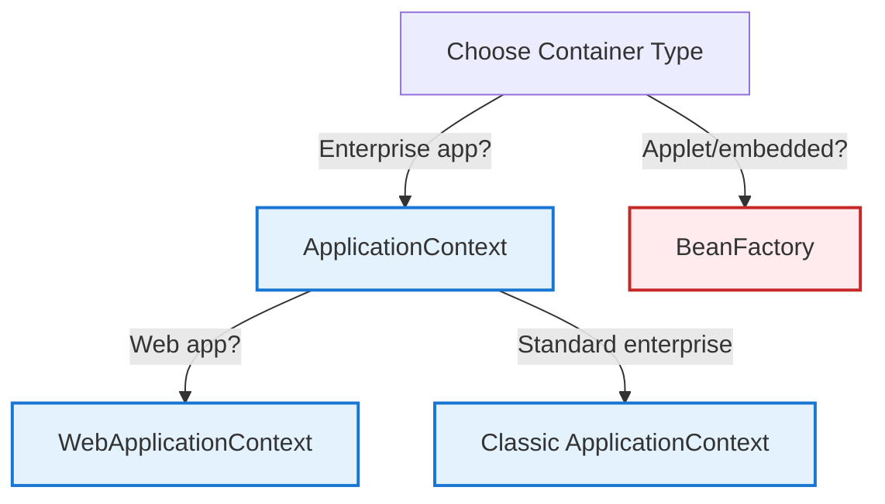
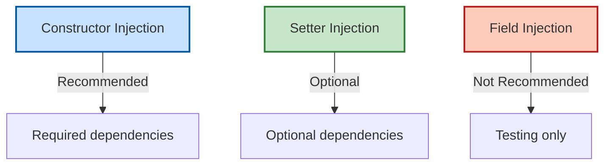
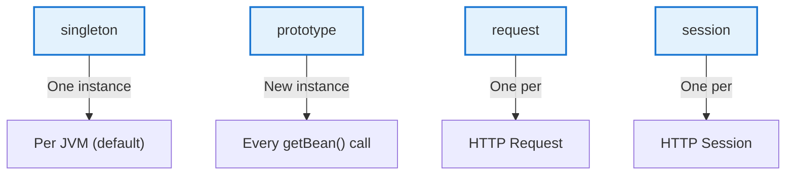
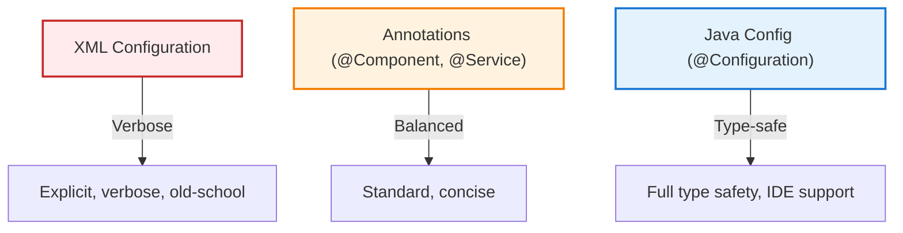
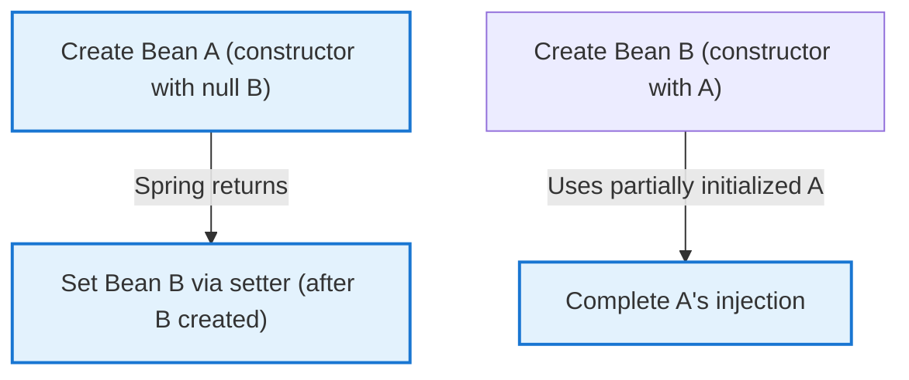
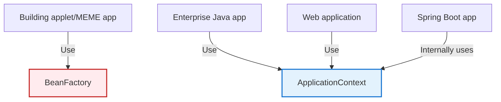

# Spring Framework Internals

## The Spring Container

The **Spring Container** is the heart of the Spring framework. It creates, configures, and manages all objects (beans) in your application. The container uses **Inversion of Control (IoC)** to achieve this.

There are two main types of Spring containers:

| Container | Key Characteristics | When to Use (Senior Perspective) |
|-----------|--------------------|----------------------------------|
| **`BeanFactory`** | Basic IoC container, lazy initialization, minimal features | **Rarely used directly** in modern enterprise apps. Best for: applets, MEME applications, or when you need a minimal footprint with no enterprise services. In your 10-year journey, you've likely never needed BeanFactory directly - Spring Boot uses ApplicationContext internally. |
| **`ApplicationContext`** | Advanced container, eager initialization, includes enterprise services | **The standard choice** for almost all enterprise applications. When to use: need `@Transactional`, `@Cacheable`, internationalization, event handling, resource loading, web applications. **Your experience**: All your microservices, EKS deployments, and the JSF→Spring Boot migration used ApplicationContext (via Spring Boot's internal `SpringApplication.run()`). |

### `BeanFactory` vs `ApplicationContext` - Senior Decision Framework

```text
┌─────────────────────────────────────────────────────────────────┐
│                   CHOOSE: BeanFactory vs ApplicationContext      │
├─────────────────────────────────────────────────────────────────┤
│                                                                 │
│  Does your app need:                                            │
│  □ @Transactional annotation?                                   │
│  □ @Cacheable annotation?                                       │
│  □ Internationalization (i18n / MessageSource)?                 │
│  □ ApplicationEvent multicasting?                               │
│  □ Resource loading from classpath/filesystem?                 │
│  □ Web scope (request/session scoped beans)?                   │
│  □ Spring Security integration?                                 │
│  □ Spring Data JPA / Mongo integration?                        │
│                                                                 │
│  IF YES to ANY → Use ApplicationContext (99% of cases)         │
│  IF NO → Use BeanFactory (edge case: applets, embedded devices)│
│                                                                 │
├─────────────────────────────────────────────────────────────────┤
```

### Mermaid: Container Hierarchy & Decision Flow


### Your Experience Mapping

| Your Project | Container Used | Why |
|-------------|---------------|-----|
| JSF → Spring Boot migration | ApplicationContext | Need @Transactional, i18n, event handling |
| Redis distributed sessions in EKS | ApplicationContext | Need session management, resource loading |
| G1GC/OOM analysis on EKS | ApplicationContext | Full Spring features for monitoring |
| 99.9% uptime targets | ApplicationContext | Complete feature set for production |
| Spring Boot microservices | ApplicationContext (internal) | SpringBootApplication.run() creates ApplicationContext |

---
*Updated: 2026-11-22 - Added senior-level decision framework and experience mapping*

---

## Inversion of Control (IoC)

### The Core Principle

**IoC**: "Don't create your objects - let the framework create and manage them."

**Traditional Java**: You `new` up dependencies directly in your code → tight coupling.

**Spring IoC**: You declare what you need, and Spring injects it → loose coupling.

```java
// ❌ Traditional approach - tight coupling
public class OrderService {
    private final OrderRepository repo = new JdbcOrderRepository(); // hardcoded dependency
}

// ✅ Spring IoC approach - loose coupling
public class OrderService {
    private final OrderRepository repo; // just declare the dependency
    
    // Spring will inject this via constructor
    public OrderService(OrderRepository repo) {
        this.repo = repo;
    }
}
```

### Benefits of IoC

1. **Loose coupling** - Classes don't create their dependencies
2. **Easier testing** - Mock dependencies can be injected
3. **Centralized management** - All beans managed in one place (the container)
4. **Improved readability** - Dependencies declared explicitly in constructor
5. **Flexible deployment** - Swap implementations without changing client code

---

## Dependency Injection (DI)

DI is a **subset of IoC**. Dependencies are "injected" into a class through:

| Injection Type | Syntax | Pros | Cons | Recommendation |
|---------------|--------|------|------|----------------|
| **Constructor** | `@Autowired` on constructor | ✅ Ensures immutability ✅ Required deps enforced ✅ Best for required deps | ❌ Can have many params (use builder pattern) | **RECOMMENDED** for required dependencies |
| **Setter** | `@Autowired` on setter method | ✅ Optional deps ✅ Can re-inject later ❌ Not thread-safe ❌ Bypasses encapsulation | Use for optional dependencies |
| **Field** | `@Autowired` on field | ❌ Breaks encapsulation ❌ Harder to test ❌ Can cause issues with proxies ❌ Not recommended | **AVOID** - only for testing frameworks |

### Constructor Injection Example

```java
// OrderService.java
@Service
public class OrderService {
    
    // Constructor injection - required dependency
    private final OrderRepository repo;
    private final NotificationService notifier;
    
    // Optional dependency with default
    private final AuditService auditService;
    
    // Required deps via constructor
    @Autowired
    public OrderService(OrderRepository repo, NotificationService notifier) {
        this.repo = repo;
        this.notifier = notifier;
        this.auditService = new AuditService(); // or use @Autowired on no-arg constructor
    }
    
    // Optional dep via setter
    public void setAuditService(AuditService auditService) {
        this.auditService = auditService;
    }
    
    public void placeOrder(Order order) {
        repo.save(order);
        notifier.sendConfirmation(order);
        auditService.log(order);
    }
}
```

### Mermaid: Dependency Injection Types


---

## Bean Lifecycle (10 Steps)

The Spring Bean Lifecycle is a well-defined process from registration to destruction. Here are the **10 steps** in order:

```text
┌────────────────────────────────────────────────────────────────────┐
│                   Spring Bean Lifecycle (10 Steps)                 │
├────────────────────────────────────────────────────────────────────┤
│  1. Bean Definition Registration                                   │
│     - XML <bean/> or @Component / @Service annotations             │
│     - Bean class, scope, init-method, destroy-method               │
│     - Configuration in: classpath, web, test contexts              │
├────────────────────────────────────────────────────────────────────┤
│  2. Instantiation                                                    │
│     - Create bean instance via constructor (or no-arg constructor) │
│     - If constructor args → DI happens here (constructor injection) │
├────────────────────────────────────────────────────────────────────┤
│  3. Dependency Injection (Constructor)                              │
│     - Spring resolves and injects constructor arguments             │
│     - If circular deps → error (or use lazy init)                  │
├────────────────────────────────────────────────────────────────────┤
│  4. Population (Setter/Field Injection)                             │
│     - Setter injection if configured                                │
│     - Field injection if configured (not recommended)               │
├────────────────────────────────────────────────────────────────────┤
│  5. Initialization - Custom init-method                             │
│     - If `init-method="myInit"` in XML or @PostConstruct           │
│     - Runs after all dependency injection                          │
├────────────────────────────────────────────────────────────────────┤
│  6. Aware Interfaces (awareness)                                    │
│     - `BeanNameAware` → setBeanName()                              │
│     - `BeanClassLoaderAware` → setBeanClassLoader()                 │
│     - `BeanFactoryAware` → setBeanFactory()                       │
│     - `ResourceLoaderAware` → setResourceLoader()                  │
│     - `ApplicationContextAware` → setApplicationContext()          │
├────────────────────────────────────────────────────────────────────┤
│  7. Post-Construction / @PostConstruct                              │
│     - If `@PostConstruct` annotated method                        │
│     - Runs after aware interfaces (if configured)                  │
├────────────────────────────────────────────────────────────────────┤
│  8. Ready for Use                                                   │
│     - Bean is fully initialized and ready                       │
│     - Application code can now use the bean                       │
├────────────────────────────────────────────────────────────────────┤
│  9. Destruction - Custom destroy-method                              │
│     - If `destroy-method="myDestroy"` in XML                       │
│     - Runs when context is closing                                 │
├────────────────────────────────────────────────────────────────────┤
│  10. DisposableBean / @PreDestroy                                    │
│     - If `implements DisposableBean`                                 │
│     - If `@PreDestroy` annotated method                            │
│     - Bean is being removed from container                         │
└────────────────────────────────────────────────────────────────────┘
```

### Mermaid: Full Bean Lifecycle Flow
```mermaid
flowchart TD
    direction TB
    B1[Bean Definition Registration] --> B2[Instantiation]
    B2 --> B3[DI (Constructor)]
    B3 --> B4[Population (Setter/Field)]
    B4 --> B5[Initialization (init-method/@PostConstruct)]
    B5 --> B6[Aware Interfaces (BeanName, BeanFactory, etc.)]
    B6 --> B7[@PostConstruct (if not already run)]
    B7 --> B8[Ready for Use]
    B8 -->|Context Closing| B9[Destruction (destroy-method/@PreDestroy)]
    B9 --> B10[DisposableBean callback]
    B10 --> B11[Garbage Collected]
    
    style B1 fill:#e3f2fd,stroke:#1976d2,stroke-width:2px
    style B8 fill:#e3f2fd,stroke:#1976d2,stroke-width:2px
    style B11 fill:#e3f2fd,stroke:#1976d2,stroke-width:2px
```

### Custom Lifecycle Methods

```java
// Using @PostConstruct and @PreDestroy (recommended)
@Service
public class OrderService {
    
    @PostConstruct
    public void init() {
        // Called after dependency injection and initialization
        System.out.println("OrderService initialized");
    }
    
    @PreDestroy
    public void cleanup() {
        // Called when context is closing
        System.out.println("OrderService destroyed");
    }
    
    // Or using XML configuration
    // <bean class="..." init-method="customInit" destroy-method="customDestroy"/>
}
```

### Important Notes on Lifecycle Order

1. **`@PostConstruct` runs AFTER** `Aware` interfaces and `init-method`
2. **`@PreDestroy` runs BEFORE** `destroy-method` (if both configured)
3. **Order matters**: `Aware` → `@PostConstruct` → business logic → `@PreConstruct` → `destroy-method`
4. **Circular dependencies** can break the lifecycle (solve with constructor injection or lazy init)

---

## Bean Scopes

Spring supports multiple bean scopes. The **default** is **singleton**.

| Scope | Description | When Created | When Destroyed |
|-------|-------------|--------------|----------------|
| **singleton** (default) | One instance per Spring IoC container (per JVM) | On first `getBean()` call | When Spring container closes |
| **prototype** | New instance every time you request it | Every `getBean()` call | Never (manual cleanup or GC) |
| **request** | One instance per HTTP request | At start of HTTP request | At end of HTTP request (context cleanup) |
| **session** | One instance per HTTP session | At start of HTTP session | At end of HTTP session |
| **application** | One instance per `ServletContext` | When `ServletContext` initialized | When `ServletContext` destroyed |
| **websocket** | One instance per WebSocket session | When WebSocket session starts | When WebSocket session ends |

### Singleton Scope Details

```text
┌─────────────────────────────────────────┐
│   Spring IoC Container (one per JVM)    │
│                                         │
│   ┌─────────────────────────────┐      │
│   │  Bean: orderService (singleton)│      │
│   │  - Same instance always         │      │
│   │  - Shared across all requests   │      │
│   └─────────────────────────────┘      │
│                                         │
│   ┌─────────────────────────────┐      │
│   │  Bean: customerService (singleton)│     │
│   │  - Same instance always           │     │
│   └─────────────────────────────┘      │
└─────────────────────────────────────────┘
```

### Prototype Scope Details

```text
┌─────────────────────────────────────────┐
│   Spring IoC Container (one per JVM)    │
│                                         │
│   Request 1: getBean("orderService")    │
│   │  ═════════════════════════════════  │
│   │  New prototype instance created │
│   └─────────────────────────────┘      │
│                                         │
│   Request 2: getBean("orderService")    │
│   │  ════════════════════════════════  │
│   │  NEW prototype instance created │
│   └─────────────────────────────┘      │
│                                         │
│   ... (each getBean() returns new instance)
└─────────────────────────────────────────┘
```

### Configuring Bean Scopes

**Annotation-based:**
```java
@Scope(value = "prototype", proxyMode = ScopedProxyMode.TARGET_CLASS)
@Component
public class OrderService { ... }
```

**XML-based:**
```xml
<bean id="orderService" class="com.example.OrderService" scope="prototype"/>
```

**Programmatic:**
```java
@Bean
@Scope("prototype")
public OrderService orderService() {
    return new OrderService();
}
```

### Mermaid: Bean Scope Comparison


---

## Bean Registration Methods

### 1. XML Configuration (Traditional)

```xml
<!-- beans.xml -->
<beans xmlns="http://www.springframework.org/schema/beans"
       xmlns:xsi="http://www.w3.org/2001/XMLSchema-instance"
       xsi:schemaLocation="http://www.springframework.org/schema/beans
       http://www.springframework.org/schema/beans/spring-beans.xsd">

    <!-- Example 1: Basic bean with scope -->
    <bean id="orderService" class="com.example.OrderService"
          scope="singleton">
        <!-- init-method and destroy-method -->
        <property name="name" value="OrderService" />
    </bean>
    
    <!-- Example 2: Bean with constructor args -->
    <bean id="orderRepository" class="com.example.JdbcOrderRepository">
        <constructor-arg value="com.example.DataSource"/>
    </bean>
    
    <!-- Example 3: Property injection -->
    <bean id="orderService" class="com.example.OrderService">
        <property name="repo" ref="orderRepository"/>
    </bean>
    
</beans>
```

### 2. Annotation-based (Component Scanning)

```java
// OrderService.java
package com.example;

import org.springframework.stereotype.Service;
import org.springframework.beans.factory.annotation.Autowired;

@Service // Registers as Spring bean with name "orderService"
public class OrderService {
    
    private final OrderRepository repo;
    
    @Autowired // Constructor injection
    public OrderService(OrderRepository repo) {
        this.repo = repo;
    }
    
    public void save(Order order) {
        repo.save(order);
    }
}
```

**Configuration class:**
```java
@Configuration
@ComponentScan("com.example") // Scan package for @Component, @Service, @Repository, @Controller
public class AppConfig {
    // No needed - component scanning finds beans automatically
}
```

### 3. Java Configuration (Modern)

```java
@Configuration
public class AppConfig {
    
    // Explicit bean definition
    @Bean
    public OrderService orderService() {
        return new OrderService(orderRepository());
    }
    
    @Bean
    public OrderRepository orderRepository() {
        return new JdbcOrderRepository(dataSource());
    }
    
    @Bean
    @Scope("prototype")
    public SomePrototypeBean prototypeBean() {
        return new SomePrototypeBean();
    }
}
```

### 4. Component Annotations

| Annotation | Stereotype | Auto-Registers As |
|------------|------------|-------------------|
| `@Component` | Generic Spring component | `<bean class="...">` |
| `@Service` | Service layer | `<bean class="...">` (stereotyped) |
| `@Repository` | Data access layer | `<bean class="...">` (stereotyped) |
| `@Controller` | MVC controller | `<bean class="...">` (stereotyped) |
| `@RestController` | `@Controller` + `@ResponseBody` | `<bean class="...">` |

### Mermaid: Registration Methods Comparison


---

## Circular Dependencies

### The Problem

When Bean A depends on Bean B, and Bean B depends on Bean A → **circular dependency**.

```java
// ❌ Circular dependency example
@Component
public class BeanA {
    private final BeanB beanB;
    
    @Autowired
    public BeanA(BeanB beanB) { this.beanB = beanB; } // Need BeanB to create BeanA
}

@Component
public class BeanB {
    private final BeanA beanA;
    
    @Autowired
    public BeanB(BeanA beanA) { this.beanA = beanA; } // Need BeanA to create BeanB
}
```

### Spring's Solutions

| Approach | How It Works | When to Use |
|----------|--------------|-------------|
| **Constructor Injection** + **Lazy Init** | Spring creates Bean A first (with null BeanB), then Bean B (with BeanA via setter), then returns to BeanA to set BeanB | Simple cases, preferred |
| **Setter Injection** | Spring creates one bean, then uses setter to inject the other (partially initialized) | Legacy code, avoid if possible |
| **`@Lazy` Annotation** | Delays bean creation until first use breaks the circle | When you can't change constructor order |
| **`@Primary`** | Marks one bean as preferred when multiple exist | Not directly for circular deps, but useful context |

### Solving Circular Dependencies with `@Lazy`

```java
@Component
public class BeanA {
    @Autowired
    @Lazy // <-- Lazy init breaks the circle
    private BeanB beanB;
    
    public BeanA(BeanB beanB) {
        this.beanB = beanB;
    }
}

@Component
public class BeanB {
    @Autowired
    private BeanA beanA; // Normal injection, BeanA already partially initialized
}
```

### Mermaid: Circular Dependency Resolution


---

## `BeanFactory` vs `ApplicationContext` - Key Differences

| Feature | `BeanFactory` | `ApplicationContext` |
|---------|--------------|---------------------|
| **Initialization** | Lazy (beans created on demand) | Eager (all beans created at startup) |
| **IoC Provider** | Basic | Advanced |
| **Enterprise Services** | No | ✅ `@Transactional`, `@Cacheable`, etc. |
| **Message Resources** | No | ✅ `MessageSource` i18n |
| **Event Publishing** | No | ✅ `ApplicationEvent` + `ApplicationListener` |
| **Resource Loading** | Basic | ✅ `ResourceLoader` |
| **Thread Scopes** | Limited | ✅ request, session scopes |
| **Recommended Use** | Applets, MEME apps | Most Java enterprise applications |

### When to Use Each

```text
USE BeanFactory When:
- Building applets or MEME applications
- Need minimal footprint
- Don't need enterprise services
- Working in very constrained environments

USE ApplicationContext When:
- Building typical enterprise Java applications
- Need `@Transactional`, `@Cacheable` etc.
- Need internationalization (i18n)
- Need event handling
- Web applications (Servlet, WebFlux)
- Most Spring Boot applications (internally uses ApplicationContext)
```

### Mermaid: When to Use Which Container


---

## Summary: Spring Framework Internals

| Concept | Key Takeaway |
|---------|--------------|
| **Spring Container** | Creates/manages beans via IoC |
| **BeanFactory vs ApplicationContext** | ApplicationContext is standard (adds enterprise services) |
| **IoC** | "Don't create objects - let Spring manage them" |
| **DI Types** | Constructor (recommended) > Setter > Field (avoid) |
| **Bean Lifecycle** | 10 steps: registration → initialization → use → destruction |
| **Bean Scopes** | singleton (default) > prototype > request/session/application/webSocket |
| **Registration** | XML (verbose) < Annotations (standard) < Java Config (type-safe) |
| **Circular deps** | Solve with constructor injection + @Lazy or setter injection |

---
*File created: 2026-11-22*
*Target: Spring Framework Internals - foundational knowledge before Spring Boot*