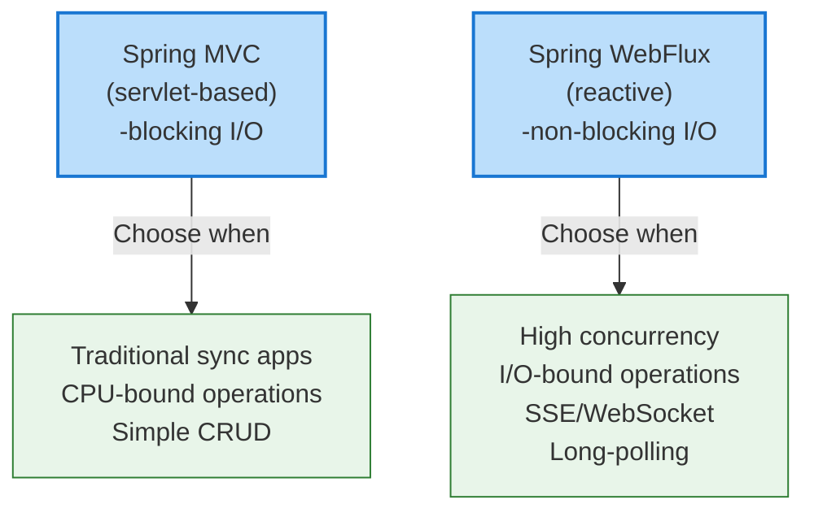
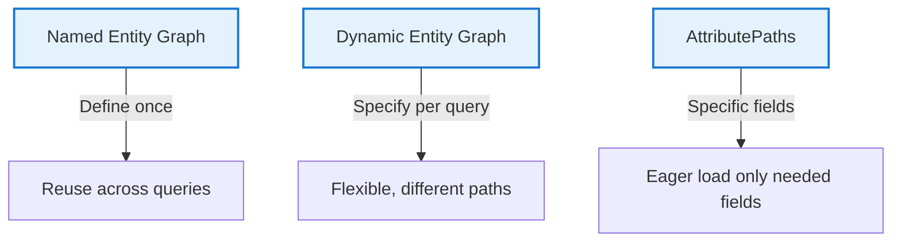
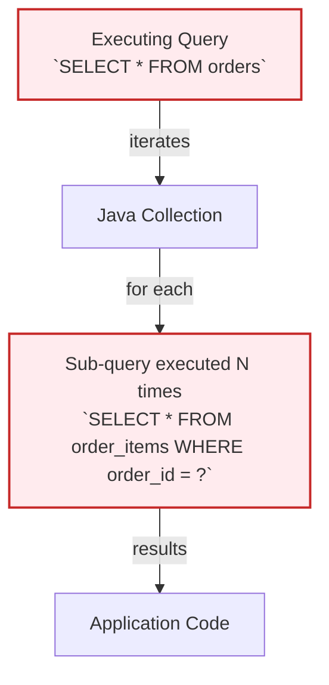

# Advanced Spring Boot

## Reactive Spring Web (WebFlux)

- **Reactive vs Imperative:** WebFlux uses `Project Reactor` (Mono, Flux) or `Vert.x`
- **Non-blocking I/O:** Uses Netty server instead of Tomcat
- **Annotations:** `@RestController`, `@RequestMapping` work the same, but return `Mono<T>` or `Flux<T>`
- **Endpoints:** `WebHandler`, `ServerWebExchange`
- **When to use:** High concurrency, long-polling, SSE, WebSocket
- **Not ideal for:** CPU-bound operations, simple CRUD where blocking is fine

```java
@RestController
@RequestMapping("/api/items")
public class ItemController {

    private final ItemService itemService;

    public ItemController(ItemService itemService) {
        this.itemService = itemService;
    }

    @GetMapping
    public Mono<List<Item>> getAll() {
        return itemService.findAll();
    }

    @GetMapping("/{id}")
    public Mono<Item> getById(@PathVariable String id) {
        return itemService.findById(id);
    }
}
```

### Mermaid: WebFlux vs MVC Comparison

```

### WebFlux vs MVC: When to Choose Which

| Criteria | Spring MVC | Spring WebFlux |
|---|---|---|
| **Underlying server** | Tomcat (blocking I/O) | Netty (non-blocking I/O) |
| **Reactive streams** | No (traditional `java.util.concurrent`) | Yes (Project Reactor `Mono`, `Flux`) |
| **Best for** | Traditional CRUD, synchronous operations | High concurrency, I/O-bound, real-time |
| **CPU-bound operations** | Fine (threads handle it) | Poor (blocking blocks event loop) |
| **WebSockets / SSE** | Supported but more complex | Native support via `WebSocketHandler` |
| **Long-polling** | Supported | Supported (easier) |
| **Error handling** | Exceptions thrown | `onErrorResume`, `onErrorMap` operators |
| **Debugging** | Standard stack traces | Reactive streams can be harder to debug |
| **IDE support** | Excellent | Good, but reactive operators less visible |

### Code Comparison

**MVC (traditional):**
```java
@GetMapping("/api/users/{id}")
public User getUser(@PathVariable Long id) {
    // Blocking call - thread waits for DB
    return userService.findById(id) // Returns User entity
        .orElseThrow(() -> new ResponseStatusException(HttpStatus.NOT_FOUND));
}
```

**WebFlux (reactive):**
```java
@GetMapping("/api/users/{id}")
public Mono<User> getUser(@PathVariable Long id) {
    // Non-blocking call - returns Mono immediately
    return userService.findByIdReactive(id) // Returns Mono<User>
        .switchIfEmpty(Mono.just(User.builder().build())) // Handle empty
        .publishOn(Schedulers.boundedElastic()); // CPU-bound ops offload
}
```

### Mermaid: Reactive Streams Flow
```mermaid
flowchart TB
    direction TB
    SOURCE["Data Source\n(DB, API, File)"] -->|subscribe| PUBLISHER[Flux/Mono Publisher]
    PUBLISHER -->|emit| EMISSION[0...N items emit]
    EMISSION -->|terminal op| RESULT[Mono<T> (1 item) or Flux<T> (many)]
    RESULT -->|subscribe| CONSUMER[Consumer/Handler]
    
    style SOURCE fill:#e3f2fd,stroke:#1976d2,stroke-width:2px
    style PUBLISHER fill:#e3f2fd,stroke:#1976d2,stroke-width:2px
    style RESULT fill:#e3f2fd,stroke:#1976d2,stroke-width:2px
```
```

## Spring Data JPA Tuning

- **`@EntityGraph`** - fetch associated entities in a single query
  ```java
  // Example: Fetch order WITHOUT N+1 problem
  @EntityGraph(attributePaths = {"customer", "orderItems"})
  Optional<Order> findById(@Param("id") Long id);
  ```
- **`@NamedNativeQuery`** - custom native SQL queries
  ```java
  @NamedNativeQuery(
      name = "Order.findByCustomerNative",
      query = "SELECT o.*, c.name FROM orders o JOIN customers c ON o.customer_id = c.id WHERE c.name = :customerName",
      resultClass = Order.class
  )
  ```
- **Pageable optimization:** 
  - Use `firstResult` and `maxResults` for pagination
  - Avoid `SELECT COUNT(*)` overhead with `count` query tuning
  - **Tip:** Set `spring.jpa.show-sql=false` and use `logging.level.org.hibernate.SQL=debug`
- **Avoid N+1 problem:** Use `@EntityGraph` or `JOIN FETCH` in queries
  ```java
  // ❌ N+1 problem: 1 + N queries
  List<Order> findAll(); // + 1 for count if pagination
  
  // ✅ Single query with JOIN FETCH
  @Query("SELECT o FROM Order o JOIN FETCH o.customer JOIN FETCH o.orderItems o")
  List<Order> findAllWithAssociations();
  
  // ✅ Using EntityGraph
  @EntityGraph(value = {"customer", "orderItems"}, type = EntityGraph.Type.LAZY)
  Optional<Order> findById(@Param("id") Long id);
  ```
- **Read-only transactions:** `@Transactional(readOnly = true)` for read operations
  - Skips optimistic version incrementing
  - Allows Hibernate to make certain optimizations
  - Prevents accidental updates
  
### Entity Graph Strategies

| Strategy | When to Use | How to Define |
|---|---|---|
| **Named Entity Graph** | Reused across multiple queries | `@EntityGraph("order-with-items")` + `@NamedEntityGraph` annotation |
| **Dynamic Entity Graph** | Different paths per query | `EntityGraph(name = "order-with-items", type = EntityGraph.Type.DYNAMIC)` |
| **AttributePaths** | Specific fields only | `@EntityGraph(attributePaths = {"field1", "field2"})` |

### Named Entity Graph Example

```java
// 1. Define the graph (can be on the entity or in a separate class)
@NamedEntityGraph(
    name = "order-with-items",
    attributePaths = {"customer", "orderItems", "orderItems.product"}
)
@Entity
public class Order { ... }

// 2. Use it in repository
@EntityGraph(value = "order-with-items", type = EntityGraph.Type.FETCH)
Optional<Order> findById(@Param("id") Long id);
```

### Mermaid: Entity Graph Strategies


### Mermaid: N+1 Problem Detection


## Spring Security 6 (JWT, OAuth2)

- **Password encoding:** `PasswordEncoder` with `BCrypt` or `Argon2`
- **JWT filter chain:** OncePerRequestFilter to validate tokens
- **`@EnableMethodSecurity`** - method-level security (new in Spring Security 6)
- **OAuth2 client/resource server:** `@EnableOAuth2Client`, `@EnableResourceServer`
- **Common filters:**
  - `UsernamePasswordAuthenticationFilter`
  - `JwtAuthenticationFilter`
  - `CsrfFilter`
- **Security configuration:**
  ```java
  @EnableMethodSecurity
  public class SecurityConfig {
      @Bean
      public SecurityFilterChain filterChain(HttpSecurity http) throws Exception {
          http
              .csrf(csrf -> csrf.disable())
              .authorizeHttpRequests(authz -> authz
                  .requestMatchers("/api/public").permitAll()
                  .anyRequest().authenticated()
              )
              .formLogin(Customizer.withDefaults())
              .logout(logout -> logout.logoutSuccessUrl("/"));
          return http.build();
      }
  }
  ```

### Mermaid: Spring Security 6 Filter Chain Order
```mermaid
flowchart TD
    direction TB
    HS[HttpSecurity.config] -->|sets up| FILTER_CHAIN[Filter Chain]
    
    FILTER_CHAIN -->|1. SecurityContextPersistenceFilter| SECURITY_CONTEXT[SecurityContext Persistence]
    SECURITY_CONTEXT -->|2. csrf()| CSRF[CsrfFilter]
    FILTER_CHAIN -->|3. sessionManagement()| SESSION_MANAGEMENT[Session Management]
    FILTER_CHAIN -->|4. httpBasic()| BASIC_AUTH[HTTP Basic Auth]
    FILTER_CHAIN -->|5. formLogin()| FORM_LOGIN[Form Login Filter]
    FILTER_CHAIN -->|6. httpBasic()| BASIC_AUTH2[HTTP Basic Auth (again)]
    FILTER_CHAIN -->|7. authorizeHttpRequests()| AUTHORIZE[Authorize Requests]
    FILTER_CHAIN -->|8. logout()| LOGOUT[Logout Filter]
    FILTER_CHAIN -->|9. headers()| HEADERS[Headers Filter]
    
    CSRF -->|enabled| CSRF_TOKEN[CSRF Token Validation]
    FORM_LOGIN -->|auth success| SECURITY_CONTEXT_HOLDER[SecurityContextHolder]
    FORM_LOGIN -->|auth failure| AUTHENTICATION_FAILURE[Authentication Failure Handler]
    
    AUTHORIZE -->|permitAll| PERMIT_ALL[Permit All]
    AUTHORIZE -->|authenticated| REQUIRE_AUTH[Require Authentication]
    
    style HS fill:#fff3e0,stroke:#f57c00,stroke-width:2px
    style SECURITY_CONTEXT_HOLDER fill:#e3f2fd,stroke:#1976d2,stroke-width:2px
```

### Mermaid: Spring Security 6 Filter Chain
```mermaid
flowchart TD
    direction TB
    HS[HttpSecurity] -->|.csrf()| CSRF[CsrfFilter]
    HS -->|.authorizeHttpRequests()| AHR[AuthorizeHttpRequestsFilter]
    HS -->|.formLogin()| FORM[UsernamePasswordAuthenticationFilter]
    HS -->|.httpBasic()| BASIC[BasicAuthenticationFilter]
    HS -->|.logout()| LOGOUT[LogoutFilter]
    HS -->|.headers()| HEAD[HeadersFilter]
    
    AHR -->|matches| PATH[RequestMatcher]
    AHR -->|permitAll| ALLOW[PermitAll]
    AHR -->|authenticated| AUTH[Authentication]
    
    FORM -->|process| LOGIN[LoginProcessingFilter]
    LOGIN -->|auth success| SECURITY_CONTEXT[SecurityContextHolder]
    LOGIN -->|auth failure| FAILURE[AuthenticationFailureHandler]
    
    BASIC -->|process| BASIC_PROCESS[BasicProcess]
    BASIC_PROCESS --> SECURITY_CONTEXT
    
    LOGOUT -->|logout success| POST_LOGIN[Forward to /]
    LOGOUT -->|CSRF check| CSRF_VERIFY[CsrfAuthenticationFilter]
    
    HEAD -->|adds headers| RESPONSE[HttpServletResponse]
    
    style HS fill:#fff3e0,stroke:#f57c00,stroke-width:2px
    style SECURITY_CONTEXT fill:#e3f2fd,stroke:#1976d2,stroke-width:2px
```

## Distributed Sessions with Redis

- **Problem:** Stateless microservices can't share HTTP session
- **Solution:** Spring Session with Redis
- **Dependency:** `spring-boot-starter-data-redis`
- **Configuration:**
  ```java
  @Configuration
  @EnableRedisHttpSession
  public class RedisConfig { }
  ```
- **Session cookies:** Automatically set `Set-Cookie` header
- **Accessing session:** `HttpSession` in controllers, or `SessionRepository`
- **Custom Redis configuration:** `RedisConfig` with `RedisConnectionFactory`

## JVM/G1GC Tuning

- **G1GC:** Default GC for heap > 16GB, pause-time focused
- **Key flags:**
  - `-XX:MaxGCPauseMillis=200` (target, not guarantee)
  - `-XX:+UseG1GC`
  - `-Xms` / `-Xmx` heap size
  - `-XX:+PrintGCDetails` / `-XX:+PrintGCDateStamps`
  - `-XX:InitiatingHeapOccupancyPercent` (G1GC initiation)
- **OOM analysis:**
  - `jmap -histo:live <pid>` - object counts
  - `jstack <pid>` - thread stacks
  - `jcmd <pid> GC.heap_dump` - heap dump
- **Common issues:**
  - `glibc malloc-arena overhead` - seen in EKS migrations
  - Too many GC pauses -> review `-XX:MaxGCPauseMillis`
  - Heap too small -> increase `-Xmx`
- **Monitoring:** Use GC logs with `OpenJDK Logging` or `Log4j 2`

---
*File created: 2026-11-19*