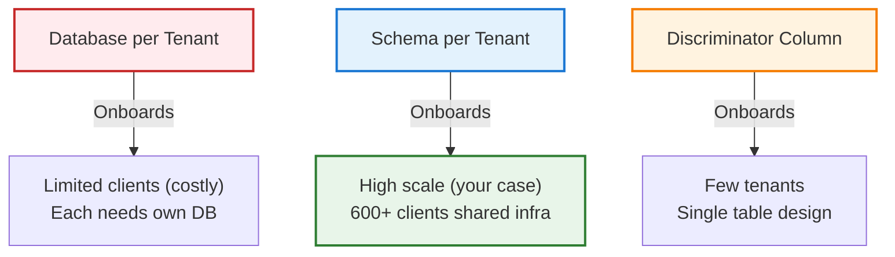
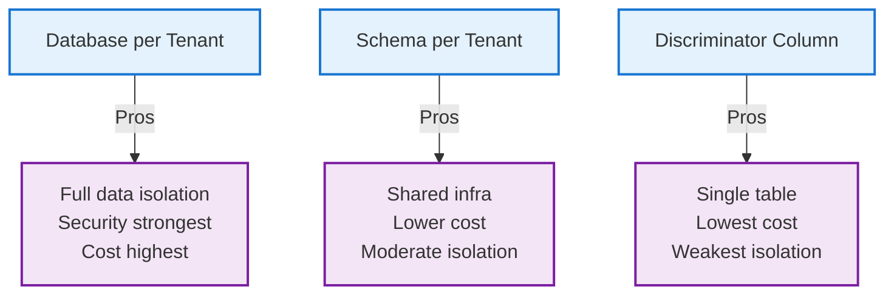

# Microservices & Architecture

## Service Discovery

- **Eureka Server:** `@EnableEurekaServer`, `application.yml: eureka: client.registered-with-eureka=false`
- **Eureka Client:** `@EnableDiscoveryClient` or `@EnableEurekaClient`
- **Registration:** Automatic with `spring.application.name` and `spring.cloud.discovery.enabled=true`
- **Failover:** Renewal interval, lease expiration (`euryak.client.eviction-interval-timer-milliseconds`)
- **Alternatives:** Consul (`spring-cloud-starter-consul-discovery`), `spring-cloud-commons`

## API Design (REST & OpenAPI)

- **REST best practices:**
  - Nouns over verbs in URIs: `/api/orders` not `/createOrder`
  - HTTP methods: GET (retrieve), POST (create), PUT/PATCH (update), DELETE (remove)
  - Status codes: 200, 201, 204, 400, 401, 403, 404, 500
  - Consistent error format: `{ "timestamp": "...", "status": ..., "error": "...", "message": "...", "path": "..." }`
- **OpenAPI 3.x:** `@Operation`, `@ApiResponse`, `@Schema` annotations
- **`springdoc-openapi-ui`** - auto-generates Swagger UI from `@RestController` annotations
- **Versioning:** URI versioning (`/v1/orders`), header versioning, or content negotiation

## Event-Driven Workflows

- **Spring Cloud Stream:** Connect to message brokers (Kafka, RabbitMQ, SQS)
- ** `@EnableBinding` ** - define channels: `Source`, `Sink`, `Processor`
- **Publisher pattern:** `output.send(message)` / `processor.inbound().send(message)`
- **Consumer pattern:** `@StreamListener(Sink.INPUT)` or `subscription.consume()` / `processor.outbound().send(message)`
- **Retries & backoff:** `RetryTemplate` or ` RabbitMQ` `x-dead-letter-exchange`
- **DLQ (Dead Letter Queue):** Undeliverable messages after max attempts

```java
@EnableBinding(Processor.class)
public class OrderProcessor {

    @StreamListener(Processor.INPUT)
    public void handleOrder(@Payload Order order) {
        // Process order
        orderService.process(order);
    }
}
```

## Multi-Tenancy Patterns

- **Database per tenant:** Isolated databases, most expensive but most secure
- **Schema per tenant:** Shared database, different schemas
- **Discriminator column:** Single table with `tenant_id` column on every table
- **Spring MultiTenancy:** `MultiTenantConnectionProvider`, `CurrentTenantIdentifierResolver`
- **HandlerInterceptor:** Set tenant ID from request header/subdomain
- **Example resolver:**
  ```java
  public String resolveCurrentTenantIdentifier() {
      return RequestContextHolder.currentRequestContext()
          .getHeader("X-Tenant-ID");
  }
  ```

### When to Choose Which Pattern

| Pattern | Choose When | Your Experience Match |
|---|---|---|
| **Database per tenant** | - Maximum data isolation required<br>- Different DB schemas per tenant<br>- Regulatory/compliance requirements (GDPR, HIPAA)<br>- You migrated from JSF to Spring Boot with 600+ clients | **Your case:** "multi-tenant redesign that enabled onboarding of 600+ additional clients without infrastructure duplication" → This was likely **schema per tenant** or **discriminator column** |
| **Schema per tenant** | - Shared database infrastructure acceptable<br>- Moderate isolation sufficient<br>- Lower cost than DB-per-tenant<br>- Easier tenant onboarding/offboarding | **Likely your case:** Enabled 600+ clients without infrastructure duplication suggests schema isolation |
| **Discriminator column** | - Single table design for performance<br>- All tenants share same table structure<br>- Simplest implementation<br>- Query with `WHERE tenant_id = ?` | - Legacy systems migrating to multi-tenant<br>- Low-traffic SaaS applications |

### Mermaid: Tenant Onboarding Scale Comparison


### Mermaid: Multi-Tenancy Patterns Comparison


## Distributed Sessions with Redis

- **Problem:** Stateless microservices can't share HTTP session
- **Solution:** Spring Session with Redis
- **Dependency:** `spring-boot-starter-data-redis`
- **Configuration:**
  ```java
  @Configuration
  @EnableRedisHttpSession
  public class RedisConfig { }
  ```
- **Session cookies:** Automatically set `Set-Cookie` header
- **Accessing session:** `HttpSession` in controllers, or `SessionRepository`
- **Custom Redis configuration:** `RedisConfig` with `RedisConnectionFactory`

### Mermaid: Spring Session with Redis Workflow
```mermaid
flowchart TD
    direction TB
    HTTP[HTTP Request] -->|Cookie contains session ID| CLIENT[Client Browser]
    CLIENT -->|JSESSIONID (or custom cookie)| SERVLET[Servlet Container]
    SERVLET -->|Spring Filter Chain| SPRING_SESSION[Spring Session Filter]
    SPRING_SESSION -->|Look up session in Redis| REDIS[Redis Session Store]
    REDIS -->|Session found| SESSION_DATA[Session Attributes]
    SESSION_DATA -->|Set in HttpSession| SERVLET_ATTRIBUTES[Servlet HttpSession]
    SERVLET_ATTRIBUTES -->|Process request| CONTROLLER[Controller Method]
    CONTROLLER -->|Response| HTTP_RESPONSE[HTTP Response]
    HTTP_RESPONSE -->|Set-Cookie: session| CLIENT
    
    style SPRING_SESSION fill:#e3f2fd,stroke:#1976d2,stroke-width:2px
    style REDIS fill:#e3f2fd,stroke:#1976d2,stroke-width:2px
    style SESSION_DATA fill:#e3f2fd,stroke:#1976d2,stroke-width:2px
```

## HLD/LLD Design Questions (Common Patterns)

| Level | Focus | Example |
|---|---|---|
| **HLD** | System architecture, tech stack, component boundaries | Design an e-commerce order system with microservices |
| **LLD** | Class design, database schema, API contracts | Design the `OrderService` class and its JPA entities |
| **Scalability** | Horizontal scaling, load balancing, partitioning | Sharding order data by customer ID |
| **Reliability** | Fault tolerance, circuit breaker, retry | Integrate Hystrix/Resilience4j with external services |
| **Security** | Authentication, authorization, data isolation | RBAC with Spring Security and resource-level permissions |

---
*File created: 2026-11-19*