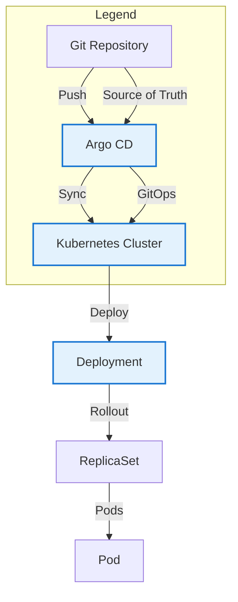

# Cloud & DevOps

## AWS EKS Application Deployment

- **Cluster creation:** `eksctl create cluster` or AWS Console
- **kubectl configuration:** `aws eks update-kubeconfig --name <cluster> --region <region>`
- **Deployment:** `kubectl apply -f kubernetes/`
- **Service types:** ClusterIP, NodePort, LoadBalancer
- **Ingress:** NGINX Ingress Controller or ALB Ingress Controller
- **Argo CD:** GitOps deployment tool for Kubernetes
  - Sync applications from Git to cluster
  - Automatic rollout on Git changes
  - Health checks and drift detection

### Mermaid: EKS Deployment Workflow


## RDS, S3 Integration

- **Amazon RDS:** MySQL, PostgreSQL, Aurora
  - Connection pooling with HikariCP
  - `spring.datasource.url=jdbc:mysql://<rds-endpoint>:3306/db`
  - SSL configuration for secure connections
- **Amazon S3:**
  - `aws-s3-spring-boot-starter` or `AmazonS3` client
  - `AmazonS3 s3 = AmazonS3ClientBuilder.standard().build();`
  - `s3.putObject(bucket, key, file)` / `s3.getObject(bucket, key)`
  - Pre-signed URLs for temporary access
  - Bucket policy and ACL management

## Docker, Kubernetes, Helm

- **Dockerfile best practices:**
  - Multi-stage builds for smaller images
  - `FROM eclipse-temurin:17-jre-float` (minimal JRE)
  - `COPY --from=builder /app/*.jar /app.jar`
  - `ENTRYPOINT ["java", "-jar", "/app.jar"]`
  - `-XX:+UseContainerSupport` for JVM container awareness
  - `-XX:MaxRAMPercentage=75.0` for Kubernetes

- **Helm charts:**
  - `Chart.yaml` - metadata (apiVersion: v2, name, version)
  - `values.yaml` - configurable values
  - `templates/` - Kubernetes manifests with Go templating
  - `happiness/livenessProbe` / `readinessProbe`

```yaml
# values.yaml
replicaCount: 3
image:
  repository: my-registry.io/spring-boot-app
  tag: "1.0.0"
  pullPolicy: IfNotPresent
service:
  type: LoadBalancer
  port: 80
resources:
  limits:
    cpu: 500m
    memory: 512Mi
```

## CI/CD Pipelines

- **GitHub Actions / GitLab CI:** Build, test, and deploy
- **Typical pipeline stages:**
  1. **Build:** `mvn clean package`
  2. **Test:** `mvn test` or `mvn verify`
  3. **Scan:** Docker scan, dependency-check
  4. **Push:** `docker push registry/image:tag`
  5. **Deploy:** `kubectl apply -f k8s/` or Argo CD sync
  6. **Notify:** Slack/webhook on success/failure

### GitHub Actions Example
```yaml
name: CI/CD Pipeline

on:
  push:
    branches: [ main ]
  pull_request:

jobs:
  build-and-test:
    runs-on: ubuntu-latest
    steps:
      - uses: actions/checkout@v4
      - name: Set up JDK
        uses: actions/setup-java@v4
        with:
          distribution: 'temurin'
          java-version: '17'
      - name: Cache Maven packages
        uses: actions/cache@v4
        with:
          path: ~/.m2/repository
          key: ${{ runner.os }}-m2-${{ hashFiles('**/pom.xml') }}
      - name: Build with Maven
        run: mvn -B clean package
      - name: Run tests
        run: mvn -B test

  deploy:
    needs: build-and-test
    runs-on: ubuntu-latest
    if: github.ref == 'refs/heads/main'
    steps:
      - uses: aws-actions/configure-aws-credentials@v4
        with:
          aws-access-key-id: ${{ secrets.AWS_ACCESS_KEY_ID }}
          aws-secret-access-key: ${{ secrets.AWS_SECRET_ACCESS_KEY }}
          aws-region: us-east-1
      - name: Deploy to EKS
        run: |
          kubectl apply -f k8s/
          kubectl rollout deployment/spring-boot-api
```

## Argo CD

- **GitOps workflow:** Store Kubernetes manifests in Git; Argo CD syncs cluster state
- **Self-healing:** Drift detection - if someone changes yaml directly, Argo CD reverts on next sync
- **Applications UI:** Visual dashboard for deployed resources
- **Sync options:** Auto-sync, Manual sync, Prune resources
- **Health checks:** Source health (Git), Cluster health (API server)

---
*File created: 2026-11-19*