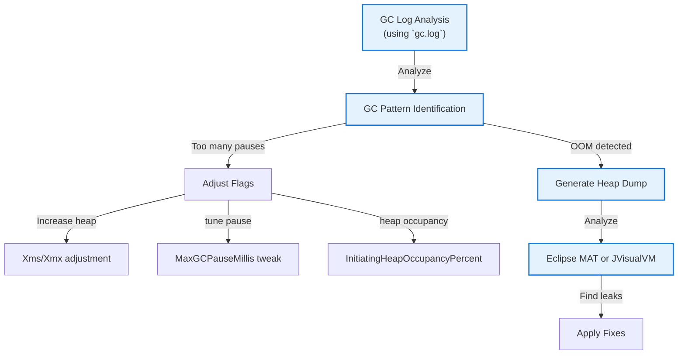

# Performance & Tuning

## Query Optimization

- **Indexing strategies:**
  - Create indexes on foreign key columns, frequently queried columns
  - Use `EXPLAIN ANALYZE` to understand query execution plans
  - Avoid `SELECT *` - project only needed columns
  - Composite indexes for queries filtering on multiple columns
- **Avoid N+1 problem:**
  - Use `@EntityGraph` or `JOIN FETCH` in JPQL
  - `countQuery` optimization in Spring Data pagination
- **Batch fetching:**
  - `@Fetch(FetchStyle.SUBSELECT)` or `@Fetch(FetchStyle.SET)`
  - `hibernate.jdbc.fetch_size` property
- **Read-replicas:** Route read queries to secondary replicas
- **Pagination optimization:**
  ```java
  // Good: seek-based pagination
  Pageable.ofSize(10).withPage(page).withSort(Sort.by("id").descending());
  
  // Bad: offset-based pagination with large offsets
  new PageRequest(page, pageSize);
  ```

## Cache Strategies

- **Redis caching:**
  - Cache key pattern: `cache:{entityType}:{id}`
  - Cache expiration: `@Cacheable(key = "#id", cacheManager = "redisCacheManager", unless = "#result == null")`
  - Cache warming for frequently accessed data
  - Distributed cache considerations: cache invalidation across instances
- **Caffeine (local cache):**
  - `Cache<Object, Object>` with Time-Based Expiration (TBE)
  - Maximum size policy: `maximumSize(1000)`
  - Write-through vs write-behind
  - Example:
    ```java
    Cache<String, User> cache = Caffeine.newBuilder()
        .maximumSize(1000)
        .expireAfterWrite(5, TimeUnit.MINUTES)
        .build();
    ```
- **Cache aside pattern:** Load -> Check cache -> Populate cache -> Return
- **Cache invalidation:** Time-based, event-driven, or write-through

## Memory Troubleshooting

- **Heap dump analysis:**
  - `jmap -dump:live,format=b,file=heap.hprof <pid>`
  - Eclipse MAT (Memory Analyzer Tool) - find leaked objects
  - JVisualVM - real-time memory monitoring
- **Common leak patterns:**
  - Static collections growing unbounded
  - Listeners/observers not deregistered
  - ThreadLocal values not cleaned up
  - Closed resources (PreparedStatement, Connection, Session)
- **GC logging configuration:**
  ```
  -Xms2g -Xmx2g -Xlog:gc*:file=gc.log:time,uptime,level,tags
  ```
- **Metaspace issues:**
  - `-XX:MaxMetaspaceSize=512m`
  - `-XX:MetaspaceSize=128m`
- **Off-heap memory:** `ByteBuffer` for large data processing

## Observability with SigNoz

- **OpenTelemetry integration:**
  - `spring-boot-starter-otel`
  - `Otp4j` or custom propagators
  - Automatic instrumentation for Spring Web, Data JPA, Redis
- **Traces:** End-to-end request flow across services
- **Metrics:** JVM metrics (GC, memory, threads), application metrics
- **Logs:** Structured logging with `spring-boot-starter-logging`
- **Dashboard setup:**
  - Service map for microservice dependencies
  - Latency breakdown per endpoint
  - Error rate and exception types
  - SQL query performance

### Example OpenTelemetry Auto-Configuration
```properties
# application.properties
spring.otel.enabled=true
spring.otel.exporter=otlp
spring.otel.exporter.otlp.endpoint=http://signoz:4317
```

## Mermaid: G1GC Tuning Workflow


## Log Analysis

- **Structured logging:** JSON format via `logstash-logback-encoder`
- **Log levels:** TRACE < DEBUG < INFO < WARN < ERROR
- **Correlation IDs:** `spring.web.correlation-filter.enabled=true`
- **Common patterns:**
  - Request/response logging (mask PII)
  - SQL query logging (slow query threshold)
  - Exception stack traces with context
- **Slow query detection:**
  ```
  spring.jpa.properties.hibernate.format_sql=true
  spring.jpa.show-sql=true
  ```
- **Audit logging:** User action tracking for compliance

---
*File created: 2026-11-19*
```